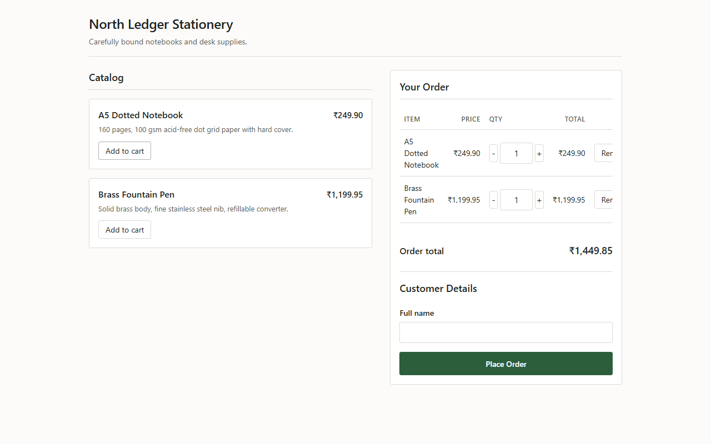
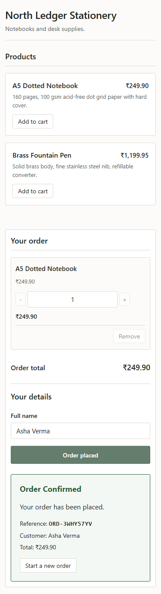

# Mini checkout and browser test suite

A single-page checkout for a made-up stationery shop (North Ledger Stationery) and a Playwright suite that tests it in the browser. This is my Round 1 submission for the Fynd Hiring Hackathon, SDET Intern track. There is no backend, database or payment step, and all data is synthetic.

## At a glance

- Tests: 10/10 passing in Chromium (2.6 s), 30/30 across browsers (17.7 s), 100/100 in stability run (24.8 s).
- Browsers: Chromium, Firefox and WebKit on Windows 11.
- Defects: 2 found and fixed (DEF-01 mobile overflow, DEF-02 desktop cart layout).
- Manual tests: 2 run by hand in Chrome (empty cart, double-click), no defects found.

## Run it

You need Node.js and npm. I built and tested everything on Windows 11 (PowerShell) with Node 26.13.0 and npm 11.20.0, and [.nvmrc](.nvmrc) says 26.

```bash
npm ci
npx playwright install
npm test
```

`npm test` starts the local web server by itself and runs the suite in Chromium.

| Command | What it does |
| --- | --- |
| `npm start` | Serves the app at http://localhost:8080 |
| `npm test` | Runs the suite in Chromium |
| `npm run test:all-browsers` | Runs it in Chromium, Firefox and WebKit |
| `npm run test:stability` | Runs every test 10 times to check for flakiness |
| `npm run report` | Opens the Playwright HTML report from the last run |
| `npm run screenshots` | Regenerates the screenshots in [docs/evidence/](docs/evidence/) |

### What you should see
This output was captured with the line reporter (`--reporter=line`) and saved in docs/evidence/test-run-chromium.txt. A plain `npm test` prints a shorter summary ending in `10 passed` and writes an HTML report, which `npm run report` opens.

```
Running 10 tests using 8 workers

[1/10] [chromium] › tests\checkout.spec.js:21:5 › Checkout Flow › Required checks › places an order and shows a single confirmation reference
[2/10] [chromium] › tests\checkout.spec.js:70:5 › Checkout Flow › Required checks › blocks checkout when the name is blank and keeps the cart
[3/10] [chromium] › tests\checkout.spec.js:112:5 › Checkout Flow › Additional risk checks › blocks checkout on empty cart with exact message and preserves typed name
[4/10] [chromium] › tests\checkout.spec.js:89:5 › Checkout Flow › Required checks › updates line and order totals exactly when a quantity changes
[5/10] [chromium] › tests\checkout.spec.js:126:5 › Checkout Flow › Additional risk checks › double-click on Place Order gives exactly one confirmation and reference stays the same
[6/10] [chromium] › tests\checkout.spec.js:162:5 › Checkout Flow › Additional risk checks › reverts invalid quantity inputs (0, abc, 21) to last valid value
[7/10] [chromium] › tests\checkout.spec.js:144:5 › Checkout Flow › Additional risk checks › two clicks in the same tick still give one confirmation
[8/10] [chromium] › tests\checkout.spec.js:195:5 › Checkout Flow › Additional risk checks › blocks Enter-key submission when name is blank
[9/10] [chromium] › tests\checkout.spec.js:206:5 › Checkout Flow › Additional risk checks › prevents horizontal viewport overflow at 375px mobile breakpoint (regression DEF-01)
[10/10] [chromium] › tests\checkout.spec.js:221:5 › Checkout Flow › Additional risk checks › ensures cart has no horizontal overflow and Remove button is fully visible at 1280px and 375px (regression DEF-02)
  10 passed (2.6s)
```

## What the app does

- Two products: A5 Dotted Notebook (₹249.90) and Brass Fountain Pen (₹1,199.95).
- Add to cart, change quantity with the - and + buttons or by typing (1 to 20), or remove a line. Line totals and the order total update straight away.
- One required field, Full name. Place Order is blocked when the cart is empty ("Add at least one item to your cart.") or the name is blank ("Enter your name to place the order."). If both apply, both messages appear. The typed name and cart are kept.
- A successful order shows one confirmation card with a reference like `ORD-AJQ22A9G`, the customer name, and the order total. The cart and name field lock, the button text changes to "Order placed", and "Start a new order" resets the page.
- Clicking Place Order twice, or pressing Enter twice, cannot place two orders.




## The three required checks

| Brief item | Test | What it asserts |
| --- | --- | --- |
| Successful checkout gives a confirmation | `places an order and shows a single confirmation reference` | Exactly one confirmation card, a reference matching `ORD-` plus 8 characters, the right total, and the customer name |
| A missing field blocks checkout | `blocks checkout when the name is blank and keeps the cart` | The exact message appears, no confirmation is created, the cart items stay intact, and the button remains enabled |
| A quantity change updates the exact total | `updates line and order totals exactly when a quantity changes` | The exact line totals and order total after each change, such as 3 x ₹249.90 = ₹749.70 |

Seven more tests in [tests/checkout.spec.js](tests/checkout.spec.js) cover the other key risks: an empty cart, a rapid double-click, two clicks in the same tick, invalid quantity inputs (0, text, 21), Enter key with a blank name, and regressions for the two layout defects below.

How the tests are written:
- Every test starts from a clean page, and `beforeEach` asserts the clean state (empty cart, total ₹0.00).
- Assertions check what a customer sees, using `getByRole`, `getByLabel` and `getByText`. There are no fixed waits.
- Retries are set to 0 so any failure is visible immediately.
- Tests run independently and do not depend on run order.

## Test results

| Run | Command | Result | Log |
| --- | --- | --- | --- |
| Chromium | `npm test` | 10 passed, 2.6 s | [docs/evidence/test-run-chromium.txt](docs/evidence/test-run-chromium.txt) |
| All browsers | `npm run test:all-browsers` | 30 passed, 17.7 s | [docs/evidence/test-run-all-browsers.txt](docs/evidence/test-run-all-browsers.txt) |
| Stability | `npm run test:stability` | 100 passed (each test 10 times), 24.8 s, 0 failures | [docs/evidence/test-run-stability.txt](docs/evidence/test-run-stability.txt) |
| Fresh copy | Temp folder with `npm ci`, `npx playwright install`, `npm test` | 10 passed | [docs/TEST_RESULTS.md](docs/TEST_RESULTS.md) |

**Breaking the app on purpose.** To prove the tests fail when the app breaks, I made three intentional edits: broke the notebook price, bypassed the empty-cart check, and disabled the double-submit guard. Each matching test failed, and I reverted the edits with git. Details are in [docs/TEST_RESULTS.md](docs/TEST_RESULTS.md).

**Scripted probes.** I also ran seven exploratory checks with a throwaway Playwright script (whitespace-only name, Enter key submit, invalid quantities, post-order locking, empty cart after removal, HTML injection prevention, and responsive width checks). Results are recorded in [docs/TEST_RESULTS.md](docs/TEST_RESULTS.md).

## Manual tests

The brief asks for two manual tests. I ran both tests by hand in Chrome on Windows 11 on 23 Nov 2026 on the final build (served with `npm start`), and I did not record the Chrome version. Full steps are in [docs/MANUAL_TESTS.md](docs/MANUAL_TESTS.md).

| ID | What I did | Expected | What I saw |
| --- | --- | --- | --- |
| MAN-01 | Ran three steps with an empty cart: typed "Asha Verma" and clicked Place Order; left name blank and clicked Place Order; added an item, removed it, and clicked Place Order | The "Add at least one item to your cart." message (and also "Enter your name to place the order." when the name is blank), no confirmation, typed name kept | Step 1 showed "Add at least one item to your cart.", no confirmation, name stayed in field. Step 2 showed both messages, name field outlined in red, no confirmation. Step 3 showed both messages again, no confirmation. Matches expected result. |
| MAN-02 | Added an item, typed "Asha Verma", and tried to click Place Order twice (single attempt) | Exactly one confirmation card, a single reference code generated, button changes to "Order placed" and disabled | First click placed the order. The button turned grey and read "Order placed", so the second click did nothing. One confirmation, reference ORD-BMUNQP2T. |

Screenshots: [docs/evidence/man-01-name-kept.png](docs/evidence/man-01-name-kept.png), [docs/evidence/man-01-empty-cart.png](docs/evidence/man-01-empty-cart.png), [docs/evidence/man-01-add-remove.png](docs/evidence/man-01-add-remove.png), and [docs/evidence/man-02-double-click.png](docs/evidence/man-02-double-click.png).

Not done: I only tried the double-click once. I did not repeat it five times, try a triple-click, press Enter twice or press Enter and then click, so those variants have no manual result.

## Defects

I found two real layout defects during development. Full steps and measurements are in [docs/DEFECTS.md](docs/DEFECTS.md).

**DEF-01: cart overflows on a phone.**
- Found by: checking element widths at 375px.
- Steps: open the page at 375px wide and add both products.
- Expected: the full cart fits within the 375px viewport.
- Actual: the table expanded to 446.58px, causing horizontal page scrolling.
- Fix: table responsive wrapper and smaller cell padding. Regression test: TC-09.
- Evidence: no before-fix screenshot was saved. The measurement above (446.58px against a 375px viewport) is the evidence. [docs/evidence/filled-cart-375px.png](docs/evidence/filled-cart-375px.png) shows the page after the fix.

**DEF-02: cart is cramped on desktop.**
- Found by: me, looking at the page in Chrome at desktop width.
- Steps: open the page at 1280px wide and add both products.
- Expected: the entire cart is visible without horizontal scroll.
- Actual: order column was only 384px wide for a 434px table. The table scrolled horizontally, Remove button was cut off by 42px, and product names wrapped onto three lines.
- Cause: introduced by the DEF-01 fix in the narrow 960px container.
- Fix: widened container to 1120px max-width, set two-column breakpoint at 900px (allocating over 550px to the cart), and stacked cart rows as cards below 600px with CSS. Regression test: TC-10 checks 1280px and 375px for zero overflow and full Remove button visibility.
- Evidence: [docs/evidence/def-02-before-1280px.png](docs/evidence/def-02-before-1280px.png) and [docs/evidence/filled-cart-1280px.png](docs/evidence/filled-cart-1280px.png).

I did not find any defects in the two manual cases.

## Test plan

The full plan is in [docs/TEST_PLAN.md](docs/TEST_PLAN.md). The risks I ranked highest for a checkout page:

1. Wrong total due to floating point math (mitigation: integer paise).
2. Duplicate order on fast double-click (mitigation: synchronous state flag and disabled button).
3. Order placed with an empty cart (mitigation: pre-submit check).
4. Order placed with blank or spaces name (mitigation: trim before validation).
5. Typed name lost on validation failure (mitigation: input value kept intact).
6. Invalid typed quantity like 0, text, or over 20 (mitigation: clamp function reverts to last valid value).
7. Cart table horizontal overflow (mitigation: CSS card stacking below 600px, wide panel above 900px).

## Design decisions

- **Integer paise.** Prices are stored as `24990` and `119995` in [app/js/cart.js](app/js/cart.js), so calculations never suffer floating point errors. [app/js/money.js](app/js/money.js) formats currency with integer arithmetic.
- **Plain HTML, CSS and JavaScript.** No framework and no bundler. Cart logic in [app/js/cart.js](app/js/cart.js) has no DOM code, and [app/js/main.js](app/js/main.js) handles UI events and rendering.
- **Double-submit guard.** A synchronous state flag blocks duplicate submissions during the same tick, and the button disables after the first valid order.
- **XSS prevention.** Customer names are inserted via `textContent`, never `innerHTML`, so HTML tags render safely as plain text.
- **Quantity cap of 20.** Keeps order totals under ₹1,00,000 where standard comma grouping is straightforward. Inputs outside 1 to 20 revert to the last valid value.
- **Playwright test suite.** Built-in waiting and visible text assertions avoid arbitrary sleep calls.

## Assumptions

1. The shop sells two synthetic products with fixed prices.
2. A customer can buy between 1 and 20 units per item.
3. Currency is Indian rupees (INR).
4. Cart state lives in memory and does not need to persist across page reloads.

## Known gaps

- Reloading the browser clears the cart because state is kept in memory.
- Orders are not sent to any backend database.
- No dedicated print stylesheet for physical receipts.
- The probe script was a throwaway and is not in the repo, so those seven results cannot be re-run.

## What I did not test

- No screen reader testing (NVDA, JAWS or VoiceOver) and no automated accessibility scan like axe.
- No physical phones or tablets (checked via Playwright viewport sizes).
- Firefox and WebKit run through Playwright bundled binaries, not installed system browsers.
- Only tested on Windows 11 with Node 26.13.0.
- No network latency or offline caching tests.
- No payment processing, because the brief excludes payments.

## Project files

- [app/index.html](app/index.html): page markup
- [app/styles.css](app/styles.css): responsive styles and card layout
- [app/js/money.js](app/js/money.js): integer paise currency formatting
- [app/js/cart.js](app/js/cart.js): pure cart state and quantity clamping
- [app/js/main.js](app/js/main.js): DOM wiring, form validation, order locking
- [tests/checkout.spec.js](tests/checkout.spec.js): 10 automated Playwright tests
- [tests/pages/checkout-page.js](tests/pages/checkout-page.js): page object with locators and helper actions
- [scripts/capture-screenshots.js](scripts/capture-screenshots.js): screenshot generator script
- [docs/TEST_PLAN.md](docs/TEST_PLAN.md): scope, risks, test cases
- [docs/TEST_RESULTS.md](docs/TEST_RESULTS.md): test runs, sensitivity checks, probes
- [docs/MANUAL_TESTS.md](docs/MANUAL_TESTS.md): manual test steps and execution records
- [docs/DEFECTS.md](docs/DEFECTS.md): defect logs for DEF-01 and DEF-02
- [docs/evidence/](docs/evidence/): test run logs and viewport screenshots
- [playwright.config.js](playwright.config.js): test configuration and web server setup
- [package.json](package.json): project scripts and devDependencies
- [.nvmrc](.nvmrc): pinned Node version


